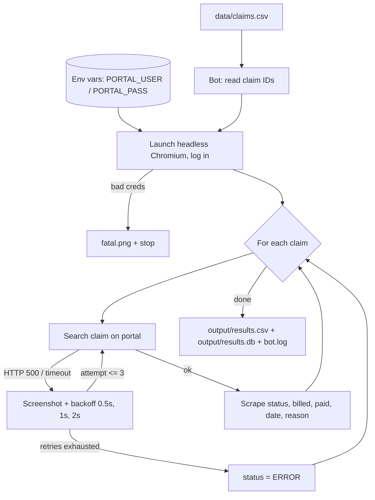

# payer-portal-bot

A browser RPA demo. A **Playwright (Python) bot** logs in to a payer portal, checks the status of each
claim listed in a CSV, and writes the results to CSV and SQLite. It retries with backoff, saves screenshots
on errors and logs every step. A tiny **mock payer portal (Flask)** is included, so the whole thing runs
offline with synthetic data only.

## Flow



| Path | Purpose |
|---|---|
| `portal/app.py` | Mock portal: login, `/claims` lookup, `PORTAL_FLAKY=1` makes every 3rd lookup fail |
| `bot/run_bot.py` | The bot: `login`, `lookup`, `lookup_with_retry`, `save`, `run` |
| `data/claims.csv` | Input work queue (includes one unknown ID to show NOT_FOUND) |
| `tests/test_bot.py` | Unit tests plus end-to-end tests against a live portal (headless) |

## Run it
```bash
python -m venv .venv && . .venv/bin/activate
pip install -r requirements.txt && playwright install chromium
python -m portal.app &                          # http://127.0.0.1:5001 (add PORTAL_FLAKY=1 to see retries)
export PORTAL_USER=demo_biller PORTAL_PASS='S3cure!pass'
python -m bot.run_bot                           # writes output/results.csv and output/results.db
pytest -v                                       # 5 tests, headless
```
See `docs/demo-output.txt`, `docs/last_page.png` and the error screenshots `docs/CLM-*_attempt1.png`.

## Design notes
- **Stable selectors** (`#claim-id`, `#r-status`) instead of screen coordinates, so the bot keeps working when the layout changes.
- **Credentials only from env vars**. In production they'd come from a vault (Azure Key Vault, CyberArk, Orchestrator Assets).
- **Fail fast on login**: bad credentials stop the run (and avoid account lockout) instead of retrying.
- **Per-item retry** with exponential backoff, so one bad claim doesn't kill the batch. Every failed attempt gets a screenshot for triage.
- **Idempotent, auditable output**: each row records `attempts` and `checked_at`.
- The bot only sees claim IDs and statuses (minimum necessary). With real PHI, screenshots would need to be stored securely and purged.

## How this maps to Power Automate Desktop / UiPath

| This project | Power Automate Desktop | UiPath |
|---|---|---|
| `read_claim_ids` (CSV) | *Read from CSV file* → DataTable | *Read CSV* → DataTable |
| env vars for creds | Credential / Azure Key Vault, Power Automate env variables | Orchestrator **Credential Asset** + *Get Credential* |
| `chromium.launch` / `page.goto` | *Launch new Chrome* | *Use Application/Browser* |
| `page.fill` / `page.click` with CSS selectors | *Populate text field* / *Press button* with UI elements | *Type Into* / *Click* with selectors (UI Explorer) |
| `page.inner_text("#r-status")` | *Get details of element on web page* | *Get Text* |
| `for cid in claim_ids` | *For each* | *For Each Row in Data Table* (or **Queue items** in REFramework) |
| `lookup_with_retry` | *On block error* → retry policy, *Loop* | *Retry Scope* / REFramework retry on System Exception |
| screenshot on error | *Take screenshot* in the error handler | *Take Screenshot* in Catch / REFramework |
| `logging` | Flow run logs / *Write to text file* | *Log Message* → Orchestrator logs |
| `save` CSV/SQLite | *Write to CSV* / *Execute SQL statement* | *Write CSV* / Database activities |
| login failure = fatal | Throw error / stop flow | **Business vs System exception** in REFramework |
| scheduling | Cloud flow trigger / unattended run | Orchestrator Triggers, unattended robots |

Same idea in each tool: a work queue, a login, a per-item transaction with retries, error evidence, and structured output.
